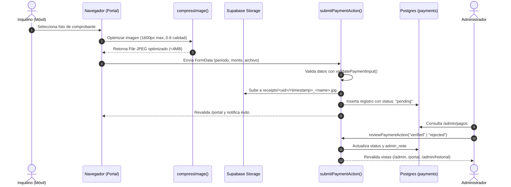

# Documentación Técnica del Código · Plaza Aragón

Este documento detalla la arquitectura, implementación técnica, flujos de datos y diseño del código de la aplicación de **Plaza Aragón**.

---

## 🏗️ 1. Arquitectura General del Sistema

El proyecto opera sobre **Next.js 16 (App Router)** combinado con **Supabase**, utilizando una arquitectura orientada a Server Components, Server Actions y Cache Components para maximizar rendimiento y seguridad.

```
┌────────────────────────────────────────────────────────┐
│                   Cliente / Navegador                  │
│       (Página pública, Portal Inquilino, Admin)        │
└──────────────────────────┬─────────────────────────────┘
                           │ HTTP Requests
                           ▼
┌────────────────────────────────────────────────────────┐
│            Next.js 16 Proxy (src/proxy.ts)             │
│  - Refresco de sesión Supabase (cookies)               │
│  - Enrutamiento por rol (JWT claim: app_metadata.role)  │
└────────────┬─────────────────────────────┬─────────────┘
             │ /admin                      │ /portal & /ingresar
             ▼                             ▼
┌───────────────────────────┐ ┌───────────────────────────┐
│     Panel Propietario     │ │    Portal Arrendatario    │
│  - requireAdmin()         │ │  - requireTenant()        │
│  - Server Actions         │ │  - Server Actions         │
│  - Auditoría de pagos     │ │  - Compresión en cliente  │
│  - Contratos & Locales    │ │  - Comprobantes & Vencim. │
└─────────────┬─────────────┘ └─────────────┬─────────────┘
              │                             │
              ▼                             ▼
┌────────────────────────────────────────────────────────┐
│              Capa de Datos (src/lib/data.ts)           │
│  - createSupabaseServerClient (SSR con Cookies)        │
│  - createSupabasePublicClient (Static / "use cache")   │
│  - createSupabaseAdminClient (Service-role autenticado)│
└──────────────────────────┬─────────────────────────────┘
                           │ Consultas & Mutaciones
                           ▼
┌────────────────────────────────────────────────────────┐
│                  Supabase Cloud Platform               │
│  - PostgreSQL + Row Level Security (RLS)               │
│  - Auth (auth.users con app_metadata)                  │
│  - Storage (Buckets: spaces [pub], receipts, contracts)│
└────────────────────────────────────────────────────────┘
```

---

## 🔒 2. Seguridad y Enrutamiento

### 2.1. Next.js 16 Proxy (`src/proxy.ts`)
En lugar del middleware legado, Next.js 16 utiliza `proxy.ts`. Este componente intercepta todas las peticiones a rutas protegidas (`/portal/*`, `/admin/*`, `/ingresar`) y ejecuta:
1. Creación del cliente de Supabase SSR usando cookies de la solicitud.
2. Extracción de claims de sesión mediante `supabase.auth.getClaims()`.
3. Verificación de permisos de administrador (`claims?.app_metadata?.role === "admin"`).
4. Redirección automática de acuerdo al estado del usuario:
   - Usuarios no autenticados en `/portal` o `/admin` $\rightarrow$ redirigidos a `/ingresar`.
   - Inquilinos autenticados intentando acceder a `/admin` $\rightarrow$ redirigidos a `/portal`.
   - Administradores intentando acceder a `/portal` $\rightarrow$ redirigidos a `/admin`.
   - Usuarios ya autenticados en `/ingresar` $\rightarrow$ redirigidos a su panel correspondiente.

### 2.2. Guardianes de Autorización (`src/lib/auth.ts`)
En el servidor (Server Components y Server Actions), la seguridad se garantiza con funciones auxiliares que validan la sesión:
- [`requireUser()`](file:///Users/juan-jose.tabuena-mejia/Documents/dev/technetica/plaza-aragon/src/lib/auth.ts): Asegura que exista un usuario activo; de lo contrario redirige a `/ingresar`.
- [`requireAdmin()`](file:///Users/juan-jose.tabuena-mejia/Documents/dev/technetica/plaza-aragon/src/lib/auth.ts): Verifica el token JWT y confirma `app_metadata.role === "admin"`. Lanza excepción o redirige si la condición no se cumple.
- [`requireTenant()`](file:///Users/juan-jose.tabuena-mejia/Documents/dev/technetica/plaza-aragon/src/lib/auth.ts): Garantiza que el usuario autenticado cuente con un registro vinculado en la tabla `tenants`.

---

## 💳 3. Ciclo de Vida del Pago y Carga de Comprobantes

El flujo de pago está optimizado para dispositivos móviles para reducir el consumo de ancho de banda y evitar desbordamientos de memoria en el navegador.



### 3.1. Compresión en Cliente (`src/lib/compress-image.ts`)
- Utiliza la API nativa del navegador `createImageBitmap` y `HTMLCanvasElement`.
- Si el archivo es imagen, calcula el factor de escala para limitar el ancho/alto a un máximo de `1600px`.
- Comprime en formato JPEG a calidad `0.8`.
- Si el resultado comprimido es mayor que el original o no es una imagen, devuelve el archivo original intacto.
- Define constante [`MAX_UPLOAD_BYTES`](file:///Users/juan-jose.tabuena-mejia/Documents/dev/technetica/plaza-aragon/src/lib/compress-image.ts#L23) en 4MB.

---

## 🏛️ 4. Modelo de Datos y Esquema Supabase

El esquema SQL reside en [supabase/schema.sql](file:///Users/juan-jose.tabuena-mejia/Documents/dev/technetica/plaza-aragon/supabase/schema.sql) y [supabase/migrations/](file:///Users/juan-jose.tabuena-mejia/Documents/dev/technetica/plaza-aragon/supabase/migrations/).

### Tablas Principales
1. **`spaces`**:
   - `id`: UUID clave primaria.
   - `name`: Nombre del espacio comercial (ej. *Local 1 - Esquinero*).
   - `description`: Descripción comercial detallada.
   - `price`: Cuota mensual en Lempiras (HNL).
   - `status`: Enum (`available`, `occupied`, `construction`).
   - `image_urls`: Array de texto con URLs de fotos públicas en Supabase Storage.
   - `sort_order`: Orden de presentación en la vitrina.

2. **`tenants`**:
   - `id`: UUID que coincide directamente con `auth.users.id`.
   - `name`: Nombre completo o razón social del arrendatario.
   - `contact_info`: Teléfono, WhatsApp o contacto principal.

3. **`leases`**:
   - `id`: UUID del contrato de arrendamiento.
   - `space_id`: Llave foránea hacia `spaces.id`.
   - `tenant_id`: Llave foránea hacia `tenants.id`.
   - `start_date` y `end_date`: Fechas ISO que delimitan el periodo de vigencia.
   - `monthly_rent`: Valor pactado de renta mensual en HNL.
   - `active`: Booleano que define si el contrato rige actualmente.
   - `contract_files`: Array de rutas relativas de archivos en el bucket `contracts`.

4. **`payments`**:
   - `id`: UUID del pago.
   - `lease_id`: Llave foránea hacia `leases.id`.
   - `amount`: Monto depositado en HNL.
   - `payment_date`: Fecha en que se realizó la transferencia.
   - `period_month` y `period_year`: Mes (1-12) y año correspondiente al alquiler.
   - `receipt_path`: Ruta del comprobante en el bucket privado `receipts`.
   - `status`: Estado de auditoría (`pending`, `verified`, `rejected`).
   - `admin_note`: Motivo de rechazo o nota administrativa.
   - `reviewed_at`: Timestamp de revisión por el administrador.

### Storage Buckets y Políticas RLS
- **`spaces` (Público):** Lectura para todo el público. Inserción, actualización y borrado restringidos exclusivamente a administradores (`public.is_admin()`).
- **`receipts` (Privado):** Arrendatarios solo pueden insertar y ver archivos ubicados dentro de su carpeta designada (`<auth.uid()>/...`). Administradores tienen acceso total de lectura. Se generan URLs firmadas temporales (1 hora) mediante `storage.createSignedUrls()`.
- **`contracts` (Privado):** Contratos firmados y anexos. Arrendatarios pueden leer los contratos asignados a sus arrendamientos; administradores tienen permisos de escritura y lectura completos.

---

## 🧰 5. Módulos y Utilidades de Negocio

### 5.1. Validación de Dominio (`src/lib/validation.ts`)
Contiene validadores desacoplados y puros para Server Actions:
- `validateSpaceUpdateInput()`: Valida nombre no vacío, estado válido (`available | occupied | construction`) y precio $\ge 0$.
- `validateLeaseInput()`: Valida selección de local, arrendatario, renta $> 0$ y fecha final posterior a la de inicio.
- `validatePaymentInput()`: Comprueba mes válido (1-12), año válido, monto $> 0$ y existencia de archivo comprobante.
- `sanitizeStorageFileName()`: Limpia el nombre del archivo eliminando caracteres especiales, truncando longitud y forzando extensiones seguras permitidas (`jpg`, `jpeg`, `png`, `webp`, `pdf`, `heic`, `heif`).

### 5.2. Formateo y Fechas (`src/lib/format.ts`)
Centraliza la localización para Honduras:
- Zona horaria: `America/Tegucigalpa`.
- `formatMoney()`: Formatea cifras a formato bancario en Lempiras hondureños (`L 8,000.00`).
- `formatDate()`: Formatea fechas ISO al español (`15 de oct. de 2026`).
- Operaciones con periodos: `currentPeriod()`, `shiftPeriod()`, `periodKey()` (`YYYY-MM`), `parsePeriodKey()`, `comparePeriods()`.

### 5.3. Catálogo y Estadísticas (`src/lib/catalog.ts`)
- `filterSpaces()`: Aplica filtros rápidos (`all`, `open`, `occupied`).
- `computeCatalogStats()`: Genera agregados de locales disponibles, en construcción, ocupados y rangos mínimos y máximos de precio.
- `getSpaceHighlights()`: Asigna etiquetas distintivas automáticas o personalizadas según el local.

---

## 🔍 6. SEO, GEO y Compatibilidad con Agentes IA

El sistema cuenta con una capa técnica optimizada para motores de búsqueda tradicionales y modelos de inteligencia artificial:
1. **Robots Dinámico (`src/app/robots.ts`):** Protege rutas de gestión privada (`/admin`, `/portal`, `/api`) y autoriza explícitamente a los rastreadores de IA (*OAI-SearchBot*, *PerplexityBot*, *ClaudeBot*).
2. **Sitemap Dinámico (`src/app/sitemap.ts`):** Publica URLs canónicas con prioridad y frecuencia de cambio.
3. **OpenGraph Programático (`src/app/opengraph-image.tsx`):** Renderiza en tiempo de ejecución tarjetas gráficas enriquecidas con la paleta de Plaza Aragón, tipografías e insignias de disponibilidad.
4. **LLMS.txt Semántico ([public/llms.txt](file:///Users/juan-jose.tabuena-mejia/Documents/dev/technetica/plaza-aragon/public/llms.txt) y [public/llms-full.txt](file:///Users/juan-jose.tabuena-mejia/Documents/dev/technetica/plaza-aragon/public/llms-full.txt)):** Provee un resumen indexable en formato Markdown limpio para motores de respuesta generativa (Perplexity, ChatGPT, Claude).

---

## 🧪 7. Pruebas Automatizadas

El proyecto utiliza el test runner nativo de Node.js (`node --test`), ejecutando pruebas unitarias y de integración sobre TypeScript sin dependencias de prueba pesadas:

```bash
npm test
```

### Cobertura de Suites:
- `src/lib/__tests__/catalog.test.ts`: Filtros de locales, agregados de catálogo, rangos de precio y casos de borde (listas vacías o precios anómalos).
- `src/lib/__tests__/compress-image.test.ts`: Comportamiento de compresión, manejo de archivos no-imagen y degradación elegante sin Canvas.
- `src/lib/__tests__/format.test.ts`: Localización de moneda HNL, fechas en español, operaciones de desbordamiento de fin de año en periodos y cálculo de días restantes.
- `src/lib/__tests__/validation.test.ts`: Validación de esquemas de locales, contratos, pagos y sanitización de nombres de archivo en almacenamiento.
- `src/lib/__tests__/seo.test.ts`: Cumplimiento de especificación llmstxt.org, robots.txt contra rutas privadas y permisos a bots de IA.
